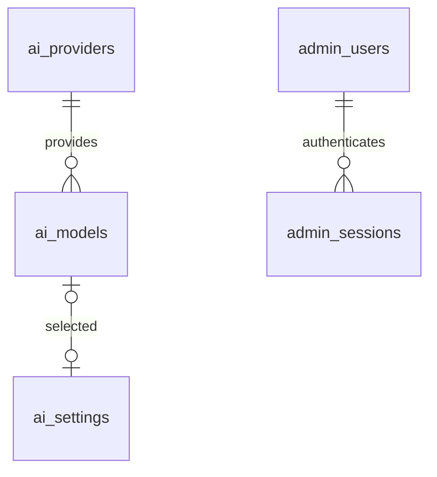

# 管理后台与模型配置

`admin/` 是独立 Vue 3 + TypeScript + Vite 项目，使用自实现组件。开发端口为 5175，`pnpm dev:admin` 单独启动；构建到 `admin/dist`，不会进入 Capacitor 包。

## 配置关系

服务商保存名称、Base URL、加密 API Key、启用状态和配置版本；模型保存服务商引用、远程模型标识、显示名称和启用状态。当前模型保存在单行设置表，空值代表未接入 AI。不能删除仍被模型引用的服务商，也不能停用或删除正在使用的模型及其服务商。

选择服务商后，管理前端请求自己的 API，由后端解密凭据并通过 `openai.models.list()` 获取模型列表。保存新模型时后端再次核验它确实属于该服务商，避免只依赖浏览器校验。模型列表与模型调用能力分别验证：“测试”会发起一次无副作用的 Responses 流式函数调用探测，不执行记账工具。实际服务商需支持此协议。

配置更改使用事务和设置行锁，以防并发修改产生无效的当前模型。每次对话运行开始时通过一次数据库查询取得完整配置快照，固定用于该次多轮工具循环。下一次运行自动使用新配置。切换模型或修改服务商后保留可读消息历史，清除旧提供商专有的 reasoning / function call 上下文。

## 代码边界

| 文件 / 目录 | 责任 |
| --- | --- |
| `admin/src/core` | 同源 API 请求与管理员登录状态 |
| `admin/src/features` | 服务商、模型、管理员各自页面 |
| `admin/src/components` | 自研弹窗、可搜索下拉列表与 SVG 图标 |
| `shared/src/admin.ts` | 无密钥的管理 DTO |
| `api/src/db` | TypeORM 实体、数据源、首次建表基线与初始化预检 |
| `api/src/admin/store.ts` | TypeORM 数据访问、事务与配置锁 |
| `api/src/admin/auth.ts` | 密码验证、会话、失败限制与撤销 |
| `api/src/admin/crypto.ts` | 密码摘要及服务商凭据加解密 |
| `api/src/admin/service.ts` | 配置约束、模型发现与协议测试 |
| `api/src/admin/routes.ts` | 管理 REST、鉴权、响应与请求来源校验 |
| `api/src/admin/runtime.ts` | 数据库配置转换为对话 Provider |

新增模型配置不修改对话调度器；新增服务商协议应增加 Provider 适配器。前端不持有 OpenAI SDK 或已保存的 API Key。修改服务商地址时要求重新填写密钥，防止旧凭据被意外发送至新地址；后端请求不跟随重定向。

管理页以列表和已保存配置摘要为主体。服务商、模型、使用配置、添加管理员与修改密码的表单由按钮打开 `AdminDialog`；保存失败显示在弹窗内并保留输入，保存成功关闭弹窗并刷新列表。取消服务商编辑会清空未保存的密钥，取消账号编辑会清空密码。删除、启停、测试和退出使用相同组件确认，测试仍提示可能产生费用。

所有下拉列表使用 `AdminSelect`，支持关键词搜索、禁用选项、方向键 / Home / End、Enter 选择和 Esc 关闭。菜单使用原生 Popover 的顶层定位，在表单弹窗中也不会被裁切，并根据视口向上或向下展开；弹窗使用原生 dialog 管理焦点和模态范围，关闭后恢复触发按钮焦点。切换服务商会取消上一请求，避免旧的远程模型列表覆盖当前选择。

## REST

前缀 `/api/v1/admin`。除登录外均需要管理员 Cookie。所有写请求还需要 `X-Admin-Request: 1`。响应与业务 API 一致，使用 `{ data }` / `{ error }`。

| 方法 | 路径 | 功能 |
| --- | --- | --- |
| POST / GET / DELETE | `/session` | 登录 / 当前管理员 / 退出 |
| PATCH | `/password` | 验证旧密码并修改，撤销所有已有会话 |
| GET / POST | `/providers` | 列表 / 新增服务商 |
| PATCH / DELETE | `/providers/:id` | 修改 / 删除服务商 |
| GET | `/providers/:id/models` | 从服务商发现模型 |
| GET / POST | `/models` | 已配置模型列表 / 新增 |
| PATCH / DELETE | `/models/:id` | 修改 / 删除模型 |
| POST | `/models/:id/test` | 测试 Responses 流与工具调用 |
| GET / PATCH | `/settings` | 查看 / 选择当前模型，`modelId: null` 停用 AI 会话 |
| GET / POST | `/users` | 管理员列表 / 创建管理员 |
| PATCH | `/users/:id` | 启停管理员 |

当前所有管理员拥有相同配置权限，不支持停用自身或停用最后一个有效管理员。后台会话有效期为 8 小时，令牌只存摘要，密码使用带独立盐的 scrypt。账号连续失败 5 次锁定 15 分钟，另有按 IP 的登录频率限制。

## 部署与验证

后台静态资源与 `/api/v1/admin` 应同源，反向代理至 API。生产使用 HTTPS 并设置 `NODE_ENV=production`，以启用 Secure Cookie。后台鉴权只覆盖管理接口；普通用户账单和对话的身份体系仍需独立实现。

`pnpm db:init` 执行完整首次初始化，同一基线重复运行不会改动已有配置；旧开发库请使用新库，详见 [初始化说明](database-initialization.md)。`pnpm admin:init` 只初始化首个管理员。加密主密钥 `api/.secrets/provider.key` 必须持久化保存并随数据库一同备份，不能在部署时重新生成。密钥、初始管理员凭据都不能放入静态发布目录。

`pnpm test:admin` 使用本地 MySQL 与本地模拟 OpenAI 服务，验证登录撤销、CSRF、密钥加密、模型发现、配置依赖、Responses 探测及真实 WebSocket 使用数据库配置。测试临时切换当前模型，结束后恢复原配置并删除自己创建的记录；在开发数据库执行。真实服务商连通性仍需填写凭据后在后台验证。

官方参考：[List models](https://developers.openai.com/api/reference/resources/models/methods/list)。

资源包商品支持草稿、发布版本与上架开关；公开额度费率独立于模型采购成本。免费用户在「用户与额度」设置，完整审计但不扣额度。操作和初始化要求见 [计费与支付](billing-and-payments.md)。
