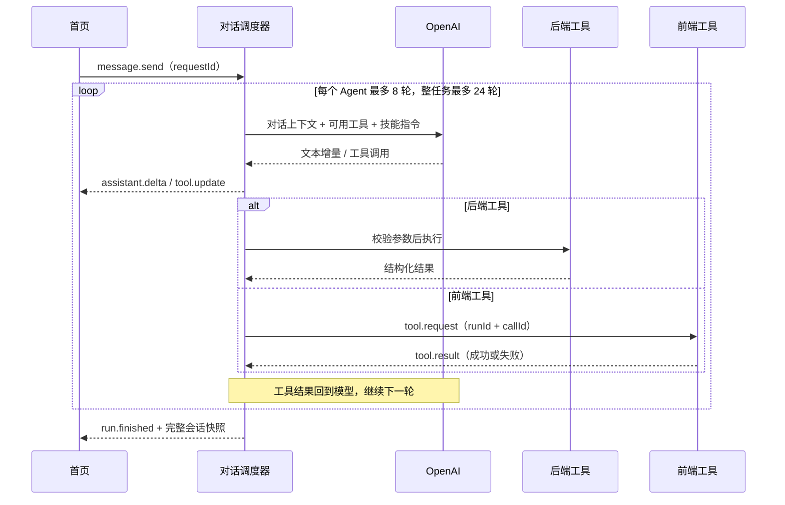

# 超级应用与对话工具架构

T Box 的主导航为 AI / OS。AI 负责会话，OS 负责手机桌面式应用入口；「设置」作为系统应用提供账号、桌面偏好及关于信息，资源、余额和任务入口由 AI 中心提供。桌面排序按账号入库，移动端和 PC 独立保存，系统应用不可卸载。桌面注册与 AI 能力注册分开，无 AI 工具的应用不需要空的工具/授权实现。页面导航、对话传输、模型接入、工具执行和业务存储各有独立边界。桌面契约与未来用户应用边界见 [OS 桌面](desktop.md)。

首页不依赖账本 UI：财务工具的目标沿用记账应用最近打开的账本，锁定或未选定时仍能普通聊天，但后端拒绝没有账本作用域的财务工具。每条消息用通用 `ResourceRef` 标记它访问过的应用资源；切换应用保留会话上下文，但恢复、重复请求和每轮模型输入前都检查历史涉及的全部资源。移除当前作用域不会解除历史内容的权限限制。

## 一次对话如何执行



已启用 AI 后，例如用户明确要求“记录买菜 35”，模型可先启用记账技能，读取数据库分类，再由后端创建 MySQL 账单，随后调用前端 `app_open`。前端导航到记账应用并回执，调度器继续生成最终回复。账单写入成功和页面打开成功是两个独立结果；页面打开失败不会撤销已写入的账单。

WebSocket 用于文字增量、工具状态与前端执行回执。账单增删改查继续使用 REST。这里不需要 Socket.IO，也不需要把 OpenAI 连接暴露给浏览器；浏览器只连接自己的 API 服务。

## 边界

| 模块                    | 责任                                              | 不应包含                         |
| ----------------------- | ------------------------------------------------- | -------------------------------- |
| `shared`                | 通用资源引用、应用元数据、DTO、WebSocket 事件协议 | SDK、密钥、Vue 组件、数据库驱动  |
| 前端应用注册 / 导航     | 将应用 ID 映射为受控页面，接收定位参数            | 模型提示词、数据库操作           |
| 前端对话状态            | 连接、会话快照、文字增量、工具状态                | 工具业务判断、模型 API Key       |
| 前端工具执行器          | 校验并执行注册的页面能力，回传结果                | 任意代码执行、任意 URL 跳转      |
| 后端对话调度器          | 运行生命周期、多轮循环、路由工具、取消和超时      | 页面组件、某一家模型的流事件细节 |
| Provider                | OpenAI Responses / Chat Completions 协议适配                         | 直接写数据库或控制页面           |
| 技能注册表              | 某项任务的说明与允许使用的工具集合                | 绕过工具权限的可执行脚本         |
| 后端工具注册表          | 输入结构、执行位置、校验与处理器                  | 对话 UI                          |
| 账本财务服务 / 分类服务 | TypeORM 事务、鉴权、幂等写入与统计投影            | 模型或 WebSocket                 |

技能是一组任务指令和工具权限的组合。它不等于 npm 插件，也不是把模型返回的代码直接执行。后续添加“待办”技能时，可以允许它使用待办工具和 `app_open`，而不自动获得记账写入能力。

## 默认模式与 OpenAI

数据库 `ai_settings.model_id` 默认为空，表示尚未接入 AI。前端显示配置提示并禁止发送，后端同样拒绝未配置的请求，不保存新会话消息、不调用工具或写入账单。服务商与模型由独立管理后台配置，详见 [管理后台架构](admin.md)。运行时每次请求读取当前配置，不需要重启；已经开始的请求使用开始时的模型配置。规则模拟仅存在于隔离测试夹具，正式运行没有本地兼容识别。

首页可通过输入 `@` 或点击应用按钮选择注册了 AI 适配器的应用；纯桌面应用不会出现在此列表。消息携带结构化 `applicationIds`，后端校验应用目录、激活对应技能并提供上下文。应用标签不等于账本选择或写入授权；账本作用域、成员权限、密码授权与必要确认仍然在工具执行时检查。标签随用户消息及历史持久化，参与请求 ID 去重比较。

OpenAI Provider 在后端使用官方 `openai` 库，模型配置选择 Responses 或 Chat Completions API。统一任务历史由适配器转换为相应接口格式。Responses 模式下，每轮保留完整响应输出（包括 reasoning / function call），按 `call_id` 补入 `function_call_output` 再继续。使用 `store: false`，不依赖 OpenAI 服务端存储会话；推理模型的加密 reasoning 内容随上下文回放。前端不接触模型密钥。

参考官方 [Function calling](https://developers.openai.com/api/docs/guides/function-calling) 与 [Streaming responses](https://developers.openai.com/api/docs/guides/streaming-responses)。模型配置与提供商适配独立于 WebSocket 协议。

## 一致性与失败处理

- 每个会话同时只运行一个请求。`requestId` 在持久化会话及任务记录中去重；客户端断线后恢复快照，不自动重发写入请求。
- 前端工具回执必须属于当前连接持有的会话、运行和待处理调用。任意其他回执不能充当后端工具结果。
- 工具调用由注册表检查名称、技能权限和输入。模型声明要调用某个名字，不代表它可以执行。
- 每个 Agent 最多 8 轮、每任务最多 24 轮及 4 次委派，普通客户端回执默认超时为 120 秒，财务确认由记账模块设为 60 秒，运行超过 300 秒停止后续调度。取消或断线不回滚已经完成的账单写入；已经发出的 SQL 会等待结果并保留记录，再释放该会话的运行锁，不能假装数据库写入已被撤销。
- 账单金额继续使用十进制字符串与 MySQL DECIMAL；工具与 REST 共用校验和仓库，不维护第二套金额规则。
- 不提供模型删除账单工具。用户仍可在账本页面使用现有确认流程修改或删除。

## 当前持久化范围

普通用户、业务数据、模型配置、登录会话、会话历史及 AI 执行任务都保存在 MySQL。`agent_tasks` 保存任务状态、执行租约、独立 Agent 上下文栈和检查点；`agent_task_tools` 保存实际派发记录、规范化副作用键及结果。任务先入库、再领取执行；同一会话只有一个未结束任务。数据库请求唯一键、执行租约和会话版本同时防止跨实例重复执行及旧快照覆盖。

运输连接及 UI 等待仍在内存里，服务重启后使用登录身份和历史会话 ID 重建连接，再从任务检查点继续。前端断线后模型和后端工具继续执行，遇到必须由前端处理的步骤进入 waiting_client；重新打开会话后自动恢复交互。服务关闭、执行超时或模型错误暂停任务；前端提供“继续任务”。已完成的工具复用结果，未知结果的写入/外部调用进入“需要核对”，不能自动重跑。密码授权和财务确认不属于执行检查点；恢复后重新校验权限，必要时重新询问，每次弹窗回执使用新的随机标识。

公开过程以 `ChatMessage.timeline` 保存，模型内部 `history` 独立；标题元数据有自动/手动来源保护。事件顺序、摘要模型配置及恢复规则见 [会话展示与通讯协议](conversation-presentation.md)。

这是可恢复的交互式任务队列，包含跨进程领取和恢复机制。没有客户端时仍能执行服务器工具，需要密码或确认时暂停等待；后台每轮重新校验登录和资源权限，不绕过用户授权；定时作业、无人值守批处理、并行多 Agent 和跨应用事务不是此队列的默认行为。任务状态图、接口、恢复边界和测试说明见 [持久任务与专业 Agent](tasks-and-agents.md)。财务事务仍独立保证数据库幂等，详见 [账本、协作与统计](ledgers.md)。

## 应用模块与运行层

运行层不导入记账、往来、分类、图片服务或 `PlatformService`。后端 `bootstrap/chat.ts` 是明确的组装入口；应用业务集中在 `apps/<app>/{contracts,web,server}/`。目前是模块化单体。应用可按复杂度声明自己的专业 Agent，无需每个简单应用都创建 Agent 或独立服务。

```text
apps/<app>/
  contracts/src/         应用自己的数据类型、纯规则和清单
  web/src/               页面、前端工具、授权/确认及业务状态
  server/src/            领域服务、REST、工具、技能、Agent 和资源权限
packages/
  app-contracts/         发布/安装/交互/资源协议
  app-shell-sdk/         可信内置应用的前端契约与显式宿主端口
  app-server-sdk/        受限工具上下文、工具 schema 和独立 HTTP 后端协议
  app-web-sdk/           独立 Web 应用消息桥
  ui-kit/                自有无业务 UI 组件
  server-foundation/    API 错误、安全、输入和幂等持久化
api/src/
  applications/registry.ts   可信应用组合
  agent/                    通用持久任务执行与多轮调度
  chat/                     模型适配、连接和会话历史
  application-platform/     安装、发布、网关与生命周期
  platform/service.ts       服务组装和数据源注入
  bootstrap/                受限上下文适配与能力注册
app/src/
  applications/registry.ts       静态页面模块注册
  applications/shellAdapter.ts   宿主服务注入
  core/app-runtime/              独立 Web 容器与平台桥接
  core/navigation.ts             通用导航
  features/chat/                 对话 UI/传输
```

工具明确声明 `execution` 和 `effect`。后端写入/外部副作用必须提供 `writeFingerprint`；注册时检查重复名称、缺失处理器及无效技能引用。技能含说明、版本、指令和工具集合，运行层只向模型提供已激活的工具及相应领域上下文；不会每轮加载所有应用业务。`@应用` 是结构化选择，不是授权。

应用接收 `ApplicationToolContext`，提供当前用户、资源作用域、任务 ID、取消信号、通用客户端交互、任务内缓存及附件视图。应用不会接收内部 `ToolContext` 中的运行注册表、模型历史、传输凭证或完整消息正文。应用工具声明需要哪些 `{resource, action}` 和是否需要确认，由执行器统一调度。权限挑战、确认文案、参数和具体接口仍由应用模块负责。图片工具通过 `attachments` 返回资源，执行器无需识别 `images_generate` 等名称。

导航协议为 `{appId, params}`，例如 `{appId:"ledger", params:{ledgerId:"...",month:"2026-10",billId:"..."}}`。通用导航不解析账本字段，参数由应用模块校验；首页发送 `scopeBindings:[{appId:"ledger",resourceType:"book",resourceId:"..."}]`。旧的 `message.send.ledgerId` 与归档字段由记账模块兼容转换，不在 AI 核心保留旧业务分支。数据库迁移将 `conversations.ledger_ids` 转为 `resource_refs` 并保留数据，新部署先运行 `pnpm db:init`。

客户端在 `session.open.clientCapabilities` 声明支持的操作；后端对不支持的私有授权/确认操作直接返回错误。能力列表不能授权数据库操作；前端 ACK 也不能代替服务端授权。旧客户端未声明能力时保留既有行为。

## 新应用接入步骤

1. 在 `apps/<app>/contracts` 声明展示信息和协议；在 `apps/<app>/web/src/module.ts` 注册页面、参数校验和组件 props。`shell` 使用外壳标题栏，`feature` 自行管理层级。应用需要全局弹窗、深链或订阅时放入自己的 Host，主框架无需加入业务代码。
2. 实现应用领域服务与 REST 接口。REST 和 AI 工具调用同一领域服务，事务、授权、余额/状态校验和持久化幂等都在领域服务中，不能只依赖 AI 执行器。
3. 实现后端 `ApplicationModule`：工具 schema/处理器、技能、可选的专业 Agent 定义、资源权限适配器、导航适配器及必要的私有客户端挑战/确认。新增工具名称使用应用前缀，避免冲突。`app_open.params` 的模型 schema 在组装时从应用导航声明生成。
4. 在后端 `applications/registry.ts` 和前端 `applications/registry.ts` 注册模块；后端由 `bootstrap/application-adapter.ts` 注入受限应用上下文。需要客户端能力时在模块声明 interactions 并注册对应白名单处理器。运行循环、首页、工具执行器和主框架无需添加应用名称分支。详细规范见 [应用接入契约](application-contract.md)。
5. 用模拟 Provider 和 WS 回执验证多轮读写、重复调用、拒绝/取消、权限到期、资源历史保护及导航。`api/test/agent-modules.test.ts` 使用测试专用笔记模块验证跨应用扩展，当前桌面包含记账、计算器、日历、时间和「我的」。

## 后续扩展的实际边界

现有运行循环继续通过后端 `openai` 库处理模型调用，Provider 和应用模块相互独立。如果后续接入 Agents SDK，应替换/适配运行层，不让 SDK 工具再次实现一套业务规则。当前 Skill 是项目内的受控任务说明，不执行任意 `SKILL.md` 脚本或模型生成代码。

已实现交互式持久任务和专业 Agent 委派。专业 Agent 顺序执行，使用独立上下文及所属模块的技能/工具白名单，由主助手汇总结果；显式 @单一应用可直接进入对应 Agent。使用后端 `openai` Responses / Chat Completions 适配，未引入第二套模型 SDK。多应用操作不天然原子；需要领域服务提供事务或补偿及明确用户确认。独立恢复 worker 已通过 TaskPort 从安全检查点续办，但不能复用交互会话的过期授权；定时批处理仍需独立作业模型。

生产反向代理需要为 `/api/v1/chat/ws` 和 `/api/v1/ledgers/ws` 转发 WebSocket Upgrade，允许连接持续超过运行超时。原生生产包的 `VITE_API_BASE_URL` 应为 HTTPS，客户端据此使用 WSS；开发模式通过 Vite 代理连接。

## 数据访问与分类扩展

应用实体由各自 `apps/<app>/server/src` 导出，`api/src/db/entities.ts` 统一组装，不使用装饰器，兼容当前 tsx 开发与 tsc 生产编译。迁移位于 `api/src/db/migrations`，数据源始终关闭自动同步。首次迁移兼容已有表，分类迁移保留旧账单并拆分其他收入 / 支出。数据库连接、Repository 及管理员参数化查询共享同一 TypeORM 数据源；事务通过 EntityManager 隔离。

分类默认值只在后端提供，创建账本时复制一份收入/支出分类到该账本。模型通过 `categories_list` 读取当前账本分类，`bills_create` 采用动态分类 ID，与 REST 共用账本财务服务及事务授权。分类添加后入库，数据库复合外键禁止跨账本/跨类型引用。`shared` 只保存 DTO。

往来工具 `debts_create`、`settlements_create` 由后端请求前端 `finance_confirm`，前端展示后端校验的账本、金额、方向与关联分配，当前运行收到有效确认后才进入财务事务。拒绝、取消、断线不授权后续写入；事务重新检查权限和余额。`ledger_statistics` 与 `debts_list` 为同一账本的读取工具，统计使用日投影与历史事件。

## 计费与支付边界

计费装饰 Provider，不在编排循环内判断模型价格、用户扣费规则或应用名称。编排仅提供执行上下文；`billing/MeteredChatProvider` 与图片服务调用 `BillingService`，价格、用户模式及费用审计在独立模块持久化。标题生成记录平台用量和成本，用户不预留余额、不扣费；同样受成本与服务商并发约束。支付订单经 `payments/PaymentGateway` 验签或查单后，在本地事务中调用同一个钱包入账服务；前端支付结果不授权入账。具体规则及微信接入点见 [计费与支付](billing-and-payments.md)。

上下文预算、真实 Responses 压缩及公开 usage 回调是通用 Provider / Agent 能力。附件投影由 AttachmentPort 还原，模型配置、费用和支付适配器分别由独立服务承载。完整边界见 [上下文与用量](ai-context-and-usage.md)。微信三个网页场景通过 PaymentGateway 接入，账户授权与凭据轮换留在 payments 模块，AI 不读取商户配置或支付认证。

## 应用 workspace 与平台运行

所有应用的领域实现已迁入 `apps`。记账、日历、时间拥有各自 contracts/web/server；设置和市场通过显式宿主端口使用平台 API，图片工具通过服务端口访问模型/资源。公共组件与通用服务抽出为 packages，宿主只组合和适配，依赖边界通过 `pnpm check:apps` 检查。详细目录与开发命令见 [应用代码目录](apps-layout.md)。

计算器继续使用独立 Web 产物与受限 MessageChannel 容器。其他应用目前是可信内置 workspace 模块，独立发布 iframe 产物需要后续桥接迁移；这次代码迁移不会改变已有安装版本、发布定义或运行模式。完整发布/安装/撤权机制见 [独立应用平台](application-platform.md)。
