# 系统发布 · 界面验收

第 04 项，2026-11-25。左侧为 Chrome 桌面，右侧为手机视口。截图使用本地管理后台生产构建和模拟候选数据，发布中断为演示状态。

## 首次进入

| 电脑 | 手机 |
| --- | --- |
| [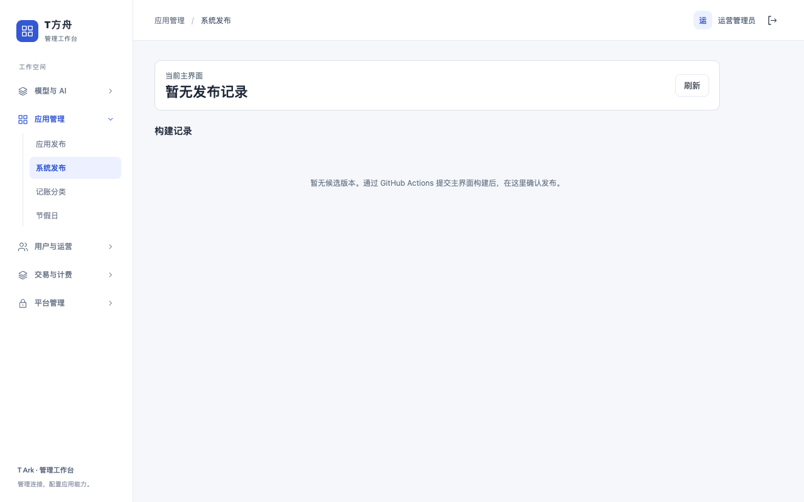](desktop-empty.png) | [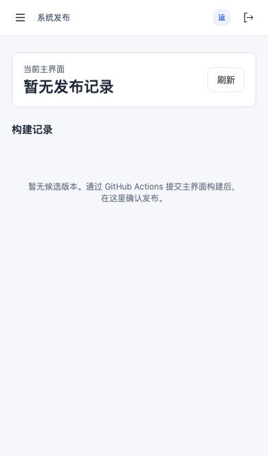](mobile-empty.png) |

## 候选列表

| 电脑 | 手机 |
| --- | --- |
| [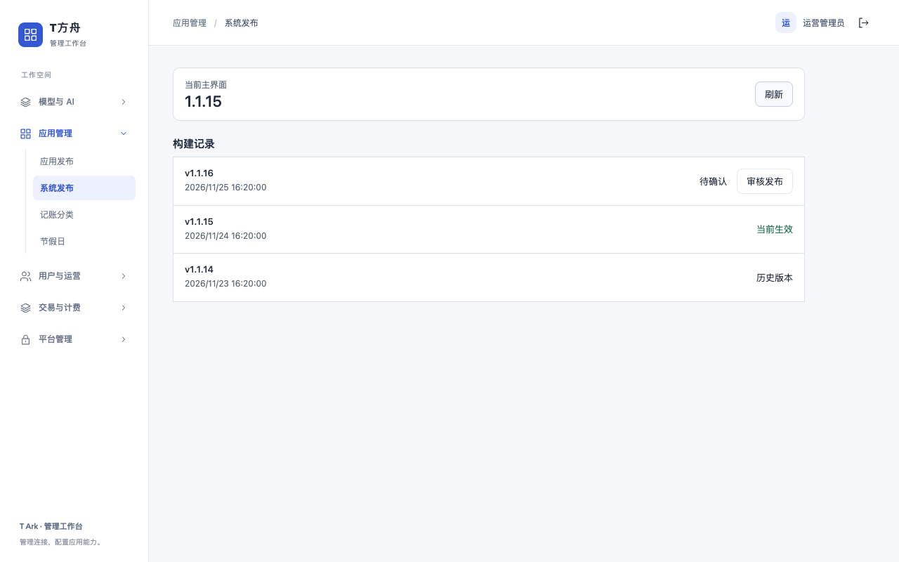](desktop-list.png) | [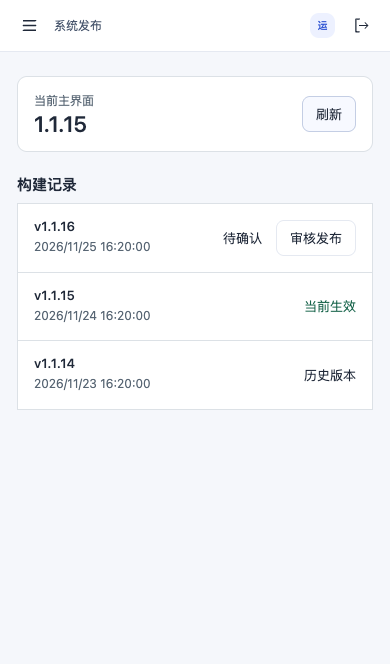](mobile-list.png) |

## 确认发布

| 电脑 | 手机 |
| --- | --- |
| [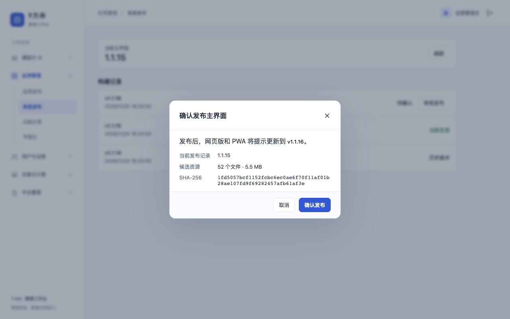](desktop-review.png) | [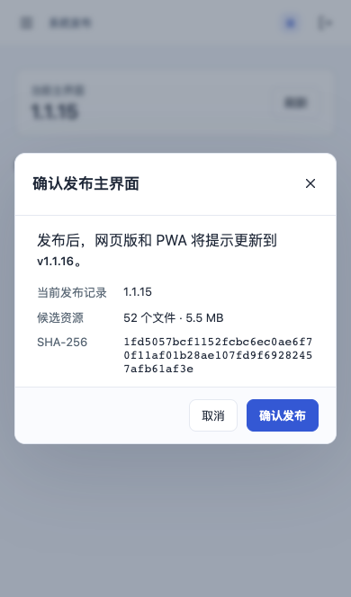](mobile-review.png) |

## 发布中

| 电脑 | 手机 |
| --- | --- |
| [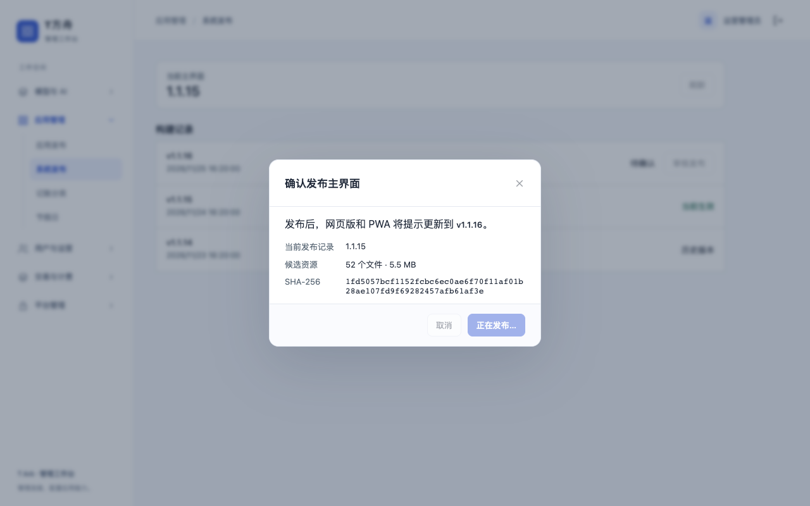](desktop-publishing.png) | [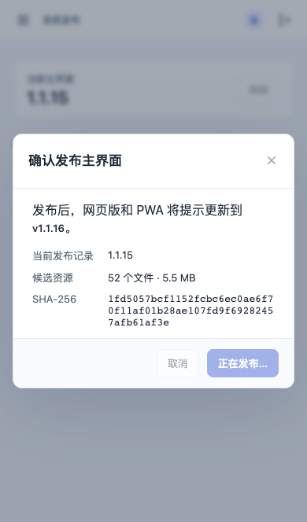](mobile-publishing.png) |

## 中断后恢复

| 电脑 | 手机 |
| --- | --- |
| [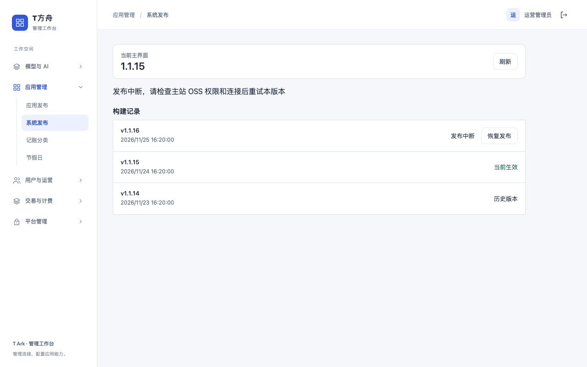](desktop-retry.png) | [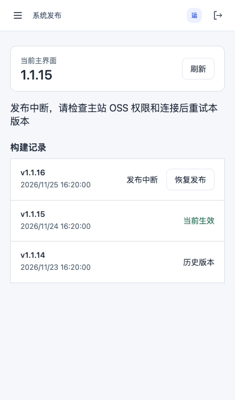](mobile-retry.png) |

## 发布完成

| 电脑 | 手机 |
| --- | --- |
| [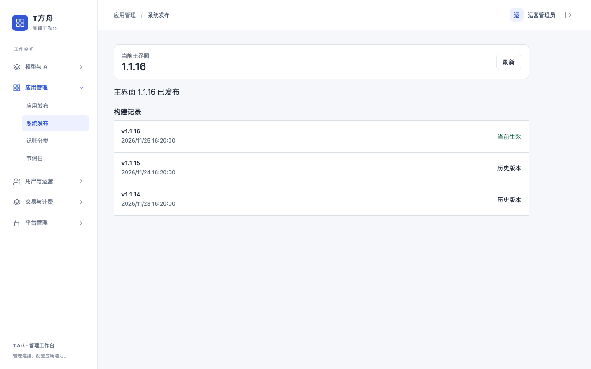](desktop-live.png) | [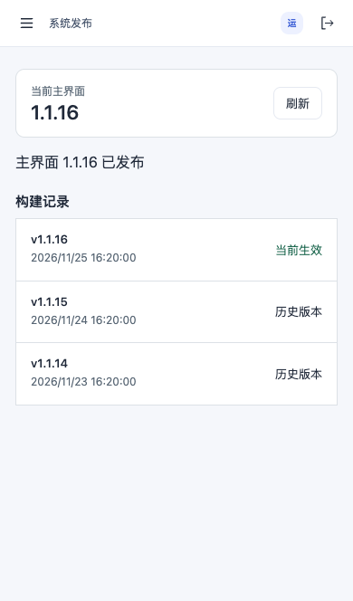](mobile-live.png) |
