# 方舟系统更新 · 界面截图

2026-11-25 · 第 01、03 项 · 样式待确认。左列为 Chrome 桌面窗口（1280 × 800），右列为 Chrome 模拟 iPhone 13（390 × 664）。点击图片可查看原尺寸。

使用本地生产模式构建与测试账号。版本从 1.1.15 更新至 1.1.16，进度截图来自实际资源校验。离线由浏览器断网触发，失败态通过让版本标记与更新包不匹配触发。安装截图展示方舟提供的操作指引。

## 安装到 Dock 或手机桌面

| 电脑 | 手机 |
| --- | --- |
| [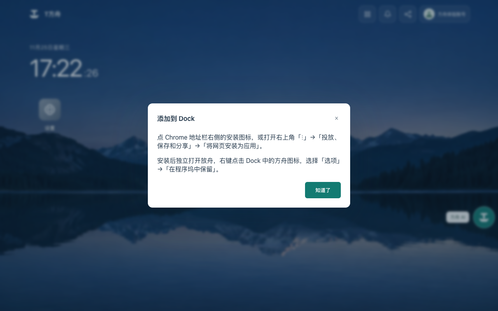](desktop-install.png) | [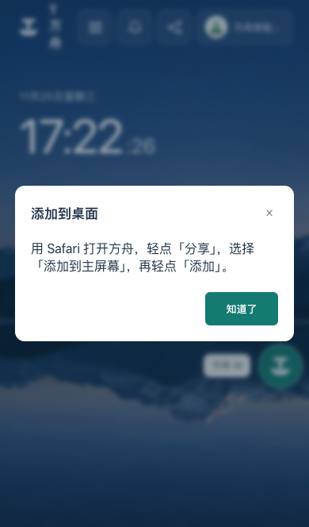](mobile-install.png) |

## 设置里的系统版本入口

| 电脑 | 手机 |
| --- | --- |
| [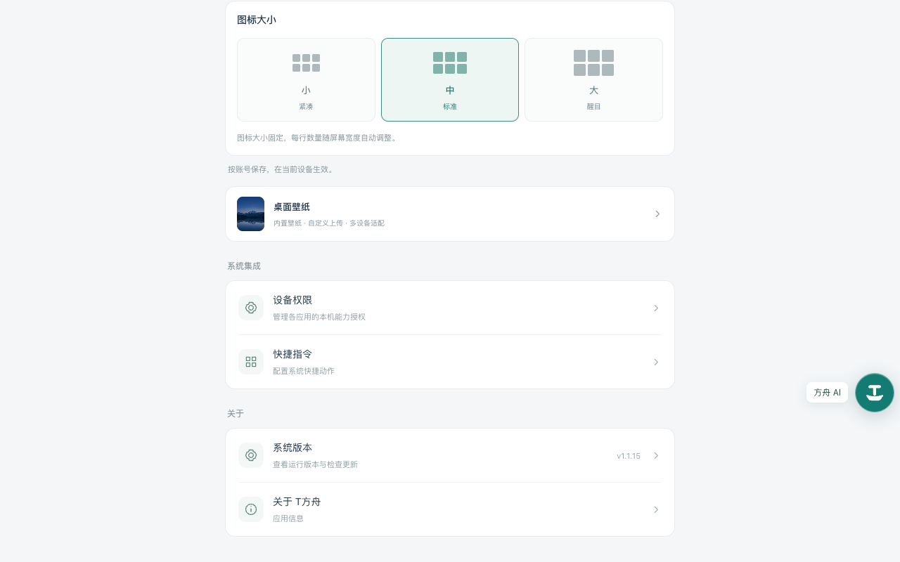](desktop-settings.png) | [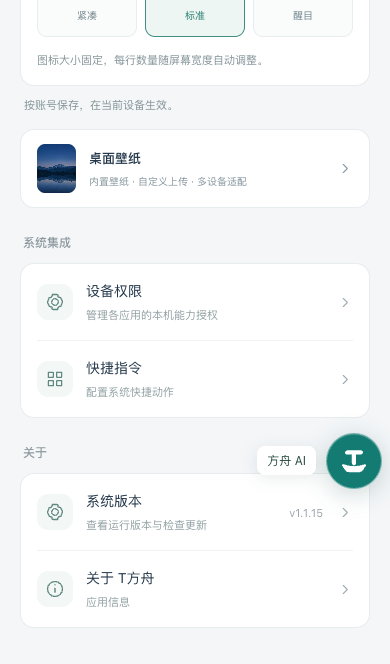](mobile-settings.png) |

## 正在检查更新

| 电脑 | 手机 |
| --- | --- |
| [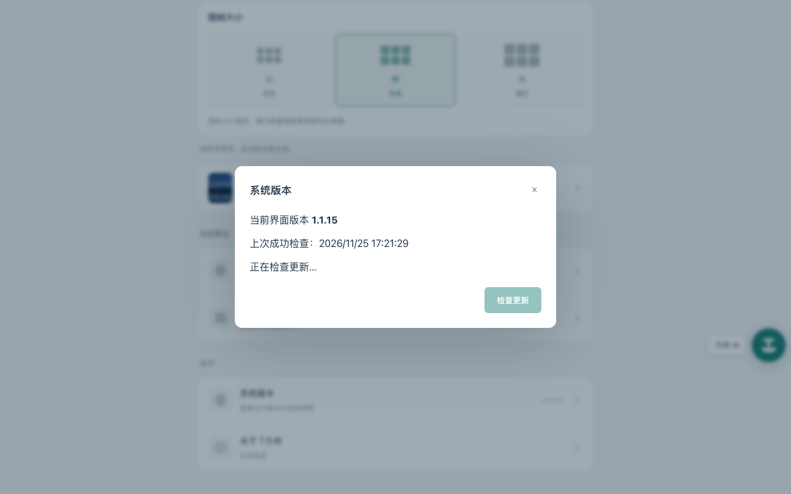](desktop-checking.png) | [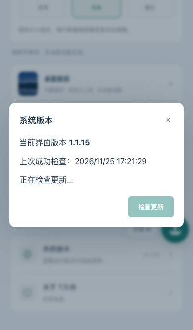](mobile-checking.png) |

## 已是最新版本

| 电脑 | 手机 |
| --- | --- |
| [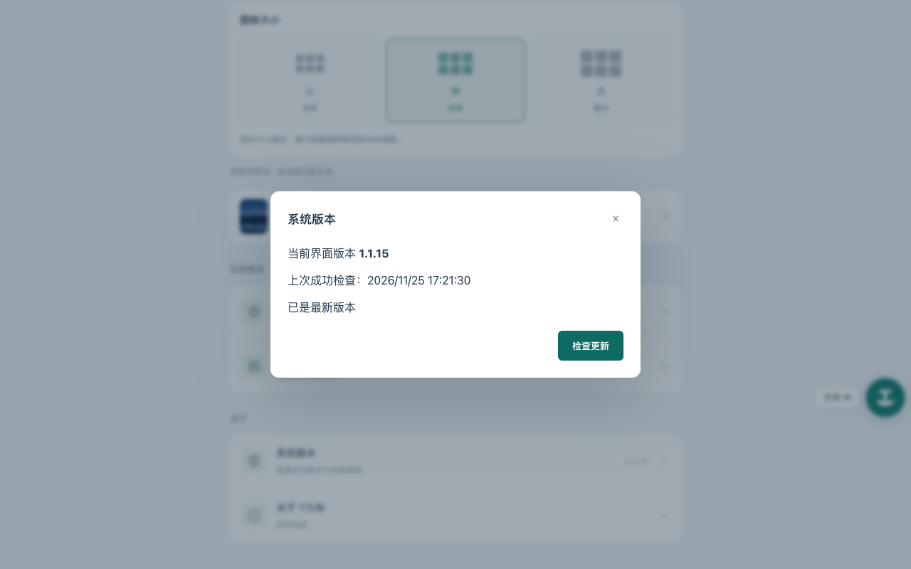](desktop-current.png) |  |

## 发现新版，等待确认

| 电脑 | 手机 |
| --- | --- |
| [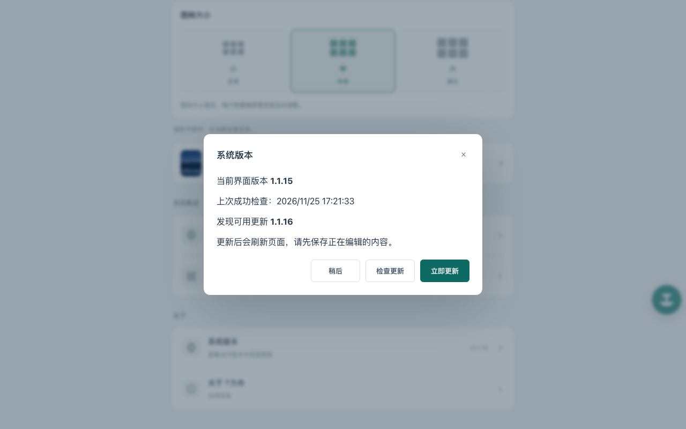](desktop-available.png) | [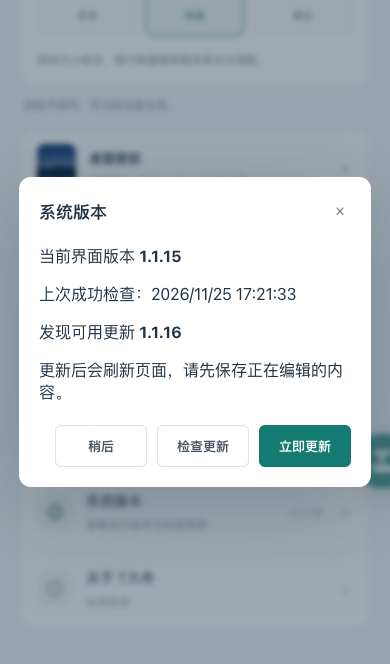](mobile-available.png) |

## 下载并校验新版资源

| 电脑 | 手机 |
| --- | --- |
| [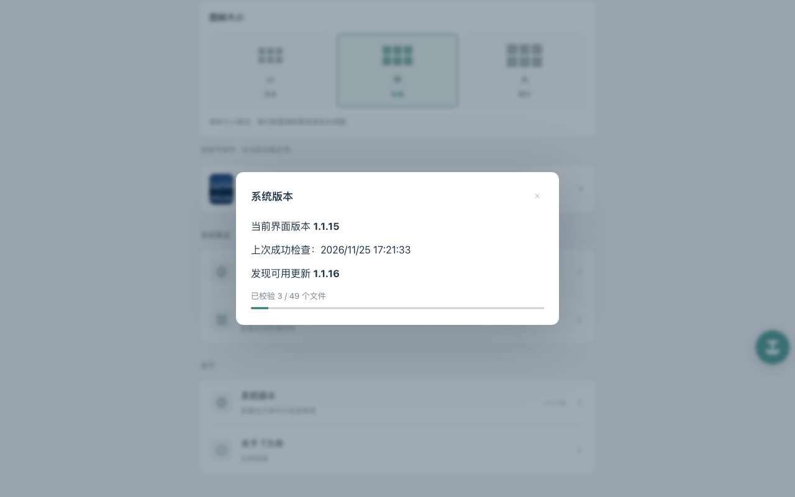](desktop-progress.png) | [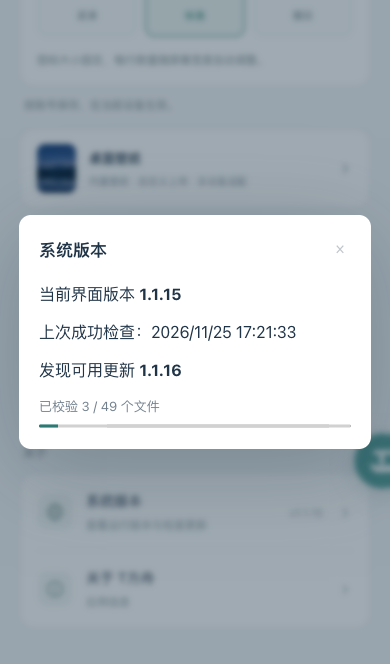](mobile-progress.png) |

## 升级后再次检查

| 电脑 | 手机 |
| --- | --- |
| [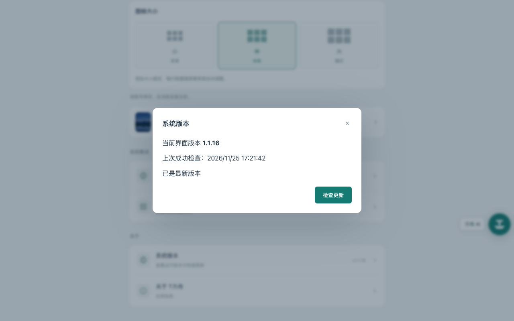](desktop-updated.png) | [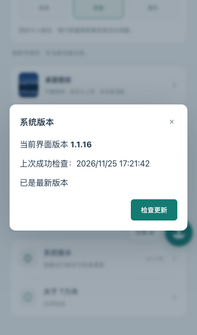](mobile-updated.png) |

## 离线检查

| 电脑 | 手机 |
| --- | --- |
| [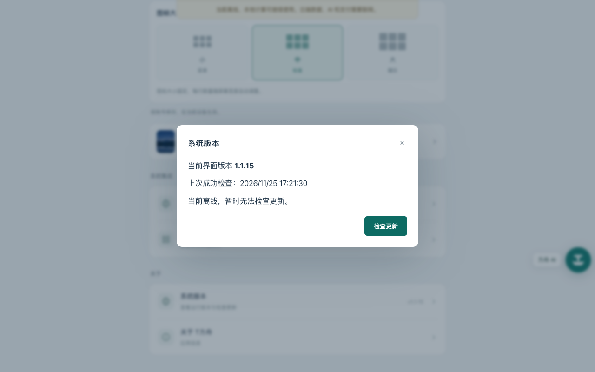](desktop-offline.png) | [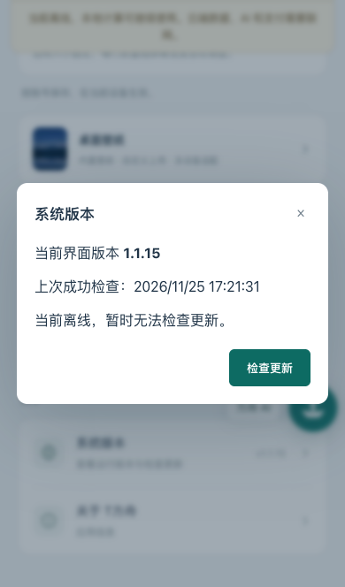](mobile-offline.png) |

## 更新失败，可以重试

| 电脑 | 手机 |
| --- | --- |
| [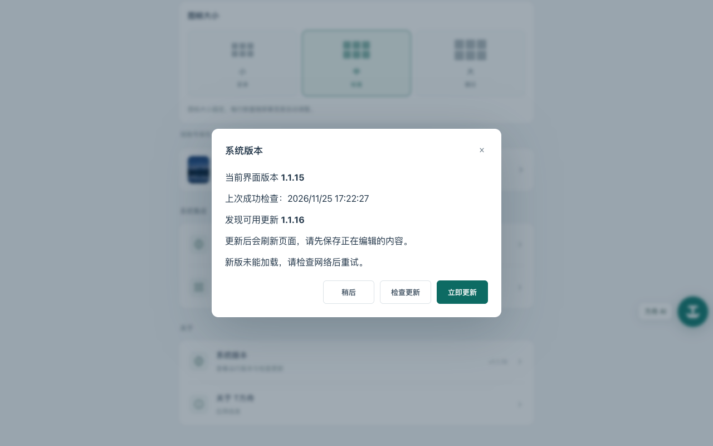](desktop-failed.png) | [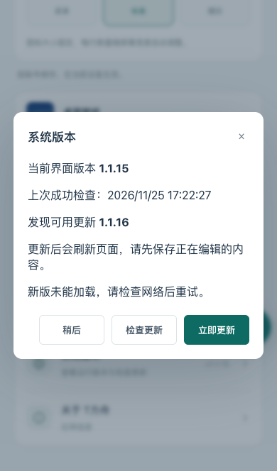](mobile-failed.png) |
