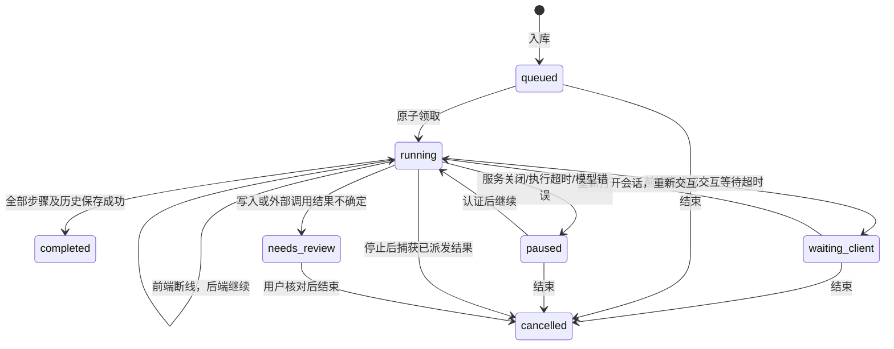

# 持久任务与专业 Agent

## 使用方式

首页普通聊天使用主助手。明确选择一个应用且该应用只有一个专业 Agent 时，直接使用该 Agent；其他情况由模型通过 `agent_delegate` 委派子任务。当前包含记账助手、图片助手。记账助手调用现有财务服务；图片助手通过普通会话模型理解需求，再调用单独配置的图片模型。普通看图/图片描述不触发图片生成。

首页显示正在处理的助手名称。“AI 中心 → 任务记录”可查看执行状态与工具记录。暂停任务可打开所属会话继续；密码资源先解锁。结果不确定时先去对应应用核对，再确认结束任务，已完成的业务操作不会撤销。运行中的任务占用所属会话；失败或暂停后可发送新消息结束旧任务，保留已完成操作。

启动方式保持 `pnpm dev`，后端单独启动为 `pnpm dev:api`。部署或更新后先运行 `pnpm db:init`。开发默认在 API 进程运行有界的自动恢复调度器；PM2 部署将 `TASK_WORKER_MODE=external`，单独启动 `dist/worker.js`（t-box-worker），不需要额外 Redis 任务队列。`TASK_WORKER_MODE=disabled` 只关闭 API 内的自动恢复；独立 worker 仍需由操作员停止。

## 任务状态与检查点

- 领取通过数据库条件更新，租约 90 秒、心跳 25 秒。检查点、工具派发和会话保存校验执行者；过期执行者不能写回覆盖新状态。会话 `revision` 防止其他 API 实例的旧快照覆盖新会话。不同连接读取的旧版本在任务入队时被拒绝，下一任务开始前重新加载历史。
- 检查点保存完整模型输出、尚未处理的调用、Agent 上下文栈、技能、轮次、规范化写入缓存及可见消息。在完整模型响应入库后才调用工具。未完成的流式文字不作为已完成模型轮次继续。
- 派发前先保存工具意图；派发后记录实际结果。结果已提交、检查点尚未提交时，恢复查询工具记录，复用结果。工具模块的 `validate` 做无副作用预检，失败不标记已派发；只有实际进入执行边界才记录意图。规范化副作用键在数据库有唯一约束，即便恢复后模型换了 call ID，也不重复同一操作。
- 读操作中断可以重新执行。写入/外部调用已派发但没有可靠结果时进入 `needs_review`，不领取、不自动重试。派发后抛错也按不确定处理，这是刻意保守的保证。无法对任意外部系统承诺 exactly-once；业务服务仍需持久化幂等键和事务。
- 前端断线只移除订阅，不中止模型流、工具循环或服务端写入。离线期间继续保存检查点、时序过程和最终结果；重连直接读取完整快照，不重新发送用户消息，也不重放已完成工具。
- 必须由前端处理的步骤在无连接、等待中断或回执超时后进入 `waiting_client`，保存尚未处理的调用并释放执行租约。重新打开所属会话后，前端自动发送一次 `task.resume`，重新请求页面操作、密码授权或确认；恢复不是自动同意。握手发生在暂停收尾期间时，会等最终快照后再恢复。普通模型错误、执行超时和不确定副作用不会自动恢复，仍由用户在任务记录处理。
- 恢复握手或任务命令遇到过期的资源授权时，`RESOURCE_LOCKED` 错误仅携带已通过成员校验的资源引用；前端关闭旧连接，通过应用自己的授权入口弹出密码输入，密码直接发送应用 API。授权成功后重建连接，取消授权则保持暂停，不循环弹窗。受保护内容在授权前不通过握手返回。
- 服务关闭仍暂停任务。强制终止后需要等原租约过期（最长约 90 秒，状态回收可能再等待一个扫描周期；读取任务时也会回收）。安全检查点由自动恢复 worker 续办；原身份无效、等待前端或副作用结果不确定时暂停。
- 日历和倒计时的设备提醒同步声明 `optional: true`：离线或同步中断返回延后状态，服务端数据保留，后端继续执行；设备下次打开时由提醒模块重新同步。密码授权、财务确认和页面导航都不是可选同步，必须等待前端。
- 恢复需有效登录、任务归属、资源权限、兼容的检查点版本、应用/Agent/技能/工具定义版本及原模型配置。模型配置变更后不回放旧供应商的推理/调用 ID；恢复原配置或核对后结束旧任务。
- 密码授权流程的密码、模型 API Key、登录 token、临时解锁凭据和私有确认回执不进检查点。附件只保存资源引用，模型调用前再读取受权限保护的内容。工具结果按应用模块约定保存，模块不得在结果中返回凭据。
- 私有弹窗使用每次交互新生成的随机 callId，绑定当前连接，旧确认和过期回执不能授权恢复后的操作。恢复确认中断的步骤会再次询问；不能把先前的“同意”作为永久许可。
- 结束任务会补齐中断调用的结果，使下一次模型输入没有孤立的 function call。删除会话前检查所有未结束任务；删除已结束会话会一并清理它的任务/工具日志。

## 模型请求自动重试

主助手和专业 Agent 共用 `agent/model-retry.ts`，重试单位是当前模型请求，不重新执行整个任务。网络中断、超时、限流、服务商 5xx、SDK 流式 `upstream_error/server_error`、未完成的连接关闭与适配器检测到的响应标识不一致/工具流格式无效可重试；参数/鉴权/额度错误、输出预算不足、内容过滤、内部代码错误、存储或计费回调失败不会自动重试。SDK 自带重试仍为 0，避免两层重试相乘。

Chat Completions 的正文和工具增量必须属于同一响应，禁止拼接不同 ID 的内容。正文已结束后的纯 usage 包可以使用网关单独的统计 ID，但用量绑定原响应 ID；该兼容不会允许混入其他正文或未完成工具。

每个逻辑模型请求最多自动重试 5 次（加上首次共 6 次），按约 1/2/4/8/16 秒退避并加抖动；尊重服务商 Retry-After，执行窗口超时和取消优先。次数、下次执行时间和已获得的完整模型响应随 Agent frame 保存；恢复不会重置次数，已保存的压缩分段响应可以复用。次数耗尽后暂停，用户显式继续可再尝试当前请求，自动预算仍不重置。单次执行窗口目前仍为 300 秒，长请求可能在达到重试上限前超时。

时间线按发生顺序显示重试原因和次数。截断的回复转为中断过程节点，下一次响应使用新流，兼容消息正文通过 `assistant.replace` 校正；完整响应提交前不派发新工具。重试期间浏览器断开，后端继续。服务关闭后由自动恢复 worker 从安全检查点继续，仍验证原登录、资源授权、应用版本与模型配置；不会重置模型重试次数。

每次实际请求有独立 operationId，用量从真实 usage 记录，不覆盖前次用量。服务商未返回 usage 的失败请求保留待核对审计，不虚构零用量、不盲目解除预留；付费账户可能因此受余额限制而提前停止。写入、外部调用和图片生成不进入这一模型请求重试循环，仍按持久工具回执和幂等规则处理。

`pnpm --filter @t-box/api test:model-retry` 使用临时数据库身份和模拟模型，覆盖时间助手创建倒计时后上游失败、持久重试检查点中断/恢复、只创建一次、回复断流重试、浏览器离线继续和独立用量审计，不请求付费模型。

## 专业 Agent 的边界

`ApplicationModule.agents` 定义 ID、名称、说明、版本、所属技能及专业指令。注册表拒绝重复 Agent ID、未知技能和跨模块技能声明。主助手保留最终回复的责任，子 Agent 返回摘要。这采用 [OpenAI 官方编排文档](https://developers.openai.com/api/docs/guides/agents/orchestration) 所述的管理者/专业助手方式，底层继续使用现有后端 `openai` 库。

修改能力语义时需更新应用/Agent/技能版本；注册表按声明元数据及工具 schema 生成版本指纹，拒绝使用不同定义继续旧任务。已完成的配置工具在复用结果时恢复本地技能状态，不重复派发。

子 Agent 有独立模型历史，只带原用户当前请求、当前附件和明确委派任务，不复制主助手的推理历史或其他应用的工具结果。它只能使用自己声明的技能和工具；不能 `skill_activate` 越界、打开其他应用或继续向其他 Agent 委派。共享用户身份、原请求 ID、资源权限边界及整个任务的副作用去重记录；委派不增加用户授权。子 Agent 访问的资源同时标记主会话，在后续模型输入、历史和任务详情中重新检查权限。

每 Agent 默认最多 8 轮，整个任务最多 24 轮、4 次委派，默认执行窗口 300 秒。到达轮数上限的任务结束；暂时模型/连接故障可继续，已执行轮数不会归零。专业 Agent 当前继承本任务开始时的普通会话模型；图片调用使用独立图片模型。未增加不必要的并行执行或 Agent 相互聊天。

接入新应用只需在模块声明工具、技能、权限及可选 Agent，再在组装入口注册。AI 运行层不导入记账/图片业务；检查点、编排、派发和任务存储通过 `AgentHost.tasks` / `TaskPort` / `ToolJournal` 对接，不在通用循环中加入应用业务判断。

## 接口与验证

- `GET /api/v1/tasks`：当前用户最近 100 个任务的状态，不返回业务内容。
- `GET /api/v1/tasks/:id`：归属及资源权限校验后的工具记录；不返回内部检查点。授权过期时，WS 最终快照隐藏受保护内容，重新授权后可恢复查看。
- `POST /api/v1/tasks/:id/cancel`：记录持久取消请求。已派发的 SQL 等待并记录结果；后台执行者下一次检查/心跳停止新步骤。
- WebSocket `task.resume {taskId}`：在当前所属会话继续任务。
- WebSocket `task.cancel {taskId}`：结束任务，当前连接执行者立即停止新步骤。
- WebSocket `agent.changed`：当前处理者发生变化，前端更新进度标签。

`pnpm test` 覆盖隔离上下文、技能/工具越权、委派结果汇总、显式应用路由、断线后服务端继续、前端等待边界及既有取消/去重逻辑。`pnpm test:tasks` 使用一次性数据库身份和模拟 Provider，覆盖离线调用模型及真实写入、前端步骤恢复不重复记账、检查点丢失后重复写入保护、专业 Agent 栈恢复、多执行者竞争、失效租约、未知外部结果阻断、读操作恢复、取消、重新确认、旧回执拒绝和任务结果权限。`pnpm test:ui-components` 检查恢复仅触发一次，不自动重试错误任务。测试不调用付费模型。

当前不提供定时调度、无人值守批处理、并行子 Agent 或通用跨应用事务。离线执行沿用本次请求的身份和有限权限，每轮仍检查登录和资源授权；权限过期时需要重新授权，不能从浏览器会话隐式继承永久授权。新任务在 API 进程执行；中断恢复可在独立 worker 执行。恢复进度通过持久快照与客户端心跳同步；逐 token 的跨进程订阅仍需独立事件分发机制。

## 后台自动恢复

新任务仅在入队未领取、执行租约到期或正常服务关闭后进入自动恢复队列。普通模型/代码错误、用户暂停、等待前端和结果不确定的副作用不自动重新运行。旧任务没有服务端身份绑定，不推断身份自动执行。

恢复身份只保存原登录的 token 哈希于专门数据库列，不写入模型检查点、前端 DTO 或工具参数；原会话退出、过期、用户禁用后，恢复暂停并要求重新登录。密码资源的授权到期后同样等待用户。不能通过无人值守执行扩大原权限。

每个调度进程最多同时恢复两个任务，可在配置中心修改 `ai.worker.concurrency`。领取前使用数据库准备租约，多个恢复进程通过 `FOR UPDATE SKIP LOCKED` 竞争；执行仍须取得原有 90 秒任务租约。最多经历五次自动恢复尝试；模型错误不参与这个重启恢复循环。重启前已完成的工具结果复用持久凭据，不确定写入进入 needs_review。前端必需操作到达时自动等待，下一次打开会话后显式继续并重新交互。

独立 worker 的实时内存与 API 分离。已连接的 API 客户端通过心跳更新该任务的持久时间线；此路径不是逐 token 的跨进程推送。目前新任务仍由接收请求的 API 执行，断开网页继续执行；独立 worker 专门负责中断恢复。不要把它描述成全部模型请求都已迁移到独立队列。
